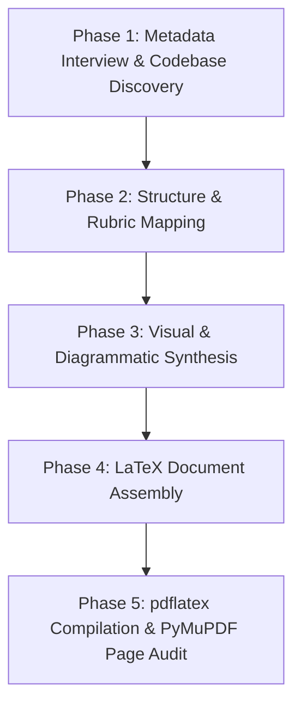

# Academic Project Report Skill

This skill provides an end-to-end autonomous workflow for transforming any software codebase, research prototype, or lab project into a publication-grade, academically compliant technical report compiled in LaTeX/PDF.

It enforces the proven institutional formatting standards (VTU / KSIT template): Times New Roman typography, 1.5 line spacing, 0.85" margins, institutional maroon running headers/footers from Chapter 1, bordered grid tables for TOC/LOF/LOT, native TikZ vector flowcharts, dedicated code listing pages, automated PyMuPDF page rendering, and layout auditing.

---

## Autonomous 5-Phase Workflow



---

### Phase 1: Upfront Academic Interview & Codebase Discovery

#### 1.1 Strict Upfront Metadata Interview
Before drafting or generating any files, prompt the user for any missing institutional and project metadata:
1. **Institution Name & Affiliation** (e.g. *K. S. Institute of Technology, Affiliated to VTU Belagavi*)
2. **Department** (e.g. *Department of Computer Science & Engineering*)
3. **Course Name & Code** (e.g. *Cryptography and Network Security - BCS502*)
4. **Batch / Allocation ID** (e.g. *Batch 2026_CNS_A_01*)
5. **Project Title & Subtitle**
6. **Student Authors** (Full Name, University Seat Number / USN, Contribution Role)
7. **Faculty Guide / Evaluator** (Name, Designation)

#### 1.2 Codebase & Artifact Discovery
Thoroughly inspect the project workspace:
- Inventory source files, modules, entry points, configuration files, and dependencies (`pyproject.toml`, `package.json`, `CMakeLists.txt`, `requirements.txt`).
- Trace core execution paths, algorithms, and data transformations.
- Run automated test suites (e.g. `pytest`, `npm test`) and record exact pass counts, execution times, Known-Answer Tests (KATs), and edge case validations.
- Check for existing documentation (`README.md`, specs, assignment briefs, or sample reports).

---

### Phase 2: Structure & Rubric Mapping

If an assignment brief or rubric is present in the workspace, map the report sections directly to that rubric. Otherwise, use the standard 8-chapter academic engineering template:

1. **Preliminary Pages (Roman Numerals `i`, `ii`, ...)**
   - **Cover / Title Page**: Institutional header, university affiliation, department, project title, course name, team details, submission date.
   - **Abstract**: Concise summary of domain, implemented modules, algorithmic paradigms, automated test results, mathematical/empirical findings, and syllabus Course Outcomes (CO) mapping.
   - **Table of Contents**: Grid table environment with borders and colored header (`#F0F0F0`).
   - **List of Figures**: Grid table environment listing all figures, flowcharts, screenshots, and page numbers.
   - **List of Tables**: Grid table environment listing all comparison tables, traces, and verification matrices.

2. **Main Body Chapters (Arabic Numerals `1`, `2`, ... with Running Maroon Headers)**
   - **Chapter 1: Introduction and Objectives**
     - Background, industry problem statement, project scope.
     - Academic objectives and Course Outcome (CO) mapping.
   - **Chapter 2: Theoretical Background / Literature Survey**
     - Mathematical principles, cryptographic/algorithmic foundations, formal definitions.
     - Comparative analysis of theoretical trade-offs.
   - **Chapter 3: System Requirements and Architecture**
     - Hardware and software toolchain specifications (OS, compiler/runtime, libraries).
     - Modular repository tree and component architecture.
   - **Chapter 4: Algorithmic Design and Methodology**
     - Algorithmic pseudocode and core implementations.
     - **Dedicated Code Listing Pages**: Assign each key algorithm a dedicated page with an annotated code block/image and functional analysis.
     - **Dedicated Architectural Flowcharts**: Individual, uncrowded TikZ vector flowcharts for each primary pipeline with accompanying explanatory text.
   - **Chapter 5: Implementation and Runtime Demonstration**
     - Source code architecture, class/function signatures, error-handling mechanisms.
     - Runtime CLI / GUI execution demonstrations and verification screenshots.
     - Data flow pipeline traces (character/byte transformations, state transitions).
   - **Chapter 6: Testing Methodology and Verification Matrix**
     - Systematic verification strategy (unit tests, KATs, boundary wrapping, negative tamper checks).
     - Full tabular verification matrix with test names, inputs, expected outputs, and pass/fail statuses.
   - **Chapter 7: Security / Performance / Experimental Analysis**
     - Cryptanalysis, complexity evaluation, benchmarking, or empirical audits.
     - Comparative matrix benchmarking the implemented solution against alternatives.
   - **Chapter 8: Applications and Conclusion**
     - Practical, real-world, and industrial use cases.
     - Limitations, future scope, and conclusive summary.

3. **End Matter**
   - **References**: Formal IEEE-style citations (standards, RFCs, textbook references, academic papers).
   - **Group Contribution Matrix**: Explicit table mapping deliverables and module ownership to student names/USNs.
   - **Project Presentation / Defense Page**: Dedicated final page featuring the official team presentation photograph / defense figure.

---

### Phase 3: Visual & Diagrammatic Synthesis

Follow the multi-tier visual asset strategy:

1. **Architectural & Pipeline Flowcharts (Native TikZ)**:
   - Always render process flowcharts as native vector graphics in LaTeX using `\begin{tikzpicture}`.
   - Use clean modern node styles with rounded corners, subtle fills (`ksitmaroon!12`), and bold titles.
   - Maintain minimum vertical node spacing (`0.30cm` to `0.40cm`) and separate decision branches cleanly.
   - **Rule**: Never cram two unrelated flowcharts onto a single page. Give each major pipeline its own page with descriptive context above or below it.

2. **Code Snippet Figures**:
   - Provide high-resolution syntax-highlighted code images or clean `listings` blocks.
   - If images are pending from the user, run `scripts/create_placeholders.py` to generate professional bordered placeholders.

3. **Runtime Execution Screenshots**:
   - Execute the project CLI/TUI and capture verbatim console output or terminal screenshots.
   - If interactive terminal screenshots are needed, provide the user with exact commands to run and capture.
   - Provide fallbacks using `create_placeholders.py`.

4. **Conceptual Diagrams**:
   - Generate high-resolution figures using Python scripts (`matplotlib`, `PIL`) or invoke the Antigravity `image-generator` subagent for conceptual artwork.

---

### Phase 4: LaTeX Document Assembly & Formatting Standards

Utilize the production-tested template located in `resources/template.tex` or adapt the reference implementation in `resources/cns_sample_reference.tex`.

#### Essential Formatting Invariants:
- **Margins**: `\usepackage[left=0.85in,right=0.85in,top=0.9in,bottom=0.9in]{geometry}`.
- **Typography**: Times New Roman for both text and math (`\usepackage{mathptmx}`).
- **Font Overflow Protection**: Always include:
  ```latex
  \renewcommand{\texttt}[1]{{\normalfont #1}}
  ```
  This prevents long monospace identifiers and filenames from breaking line wrapping and overflowing page margins.
- **Line Spacing**: Standard 1.5 line spacing (`\usepackage{setspace}\onehalfspacing`).
- **Institutional Running Headers**:
  - Top & bottom maroon rules (1.8pt) via `fancyhdr`:
    ```latex
    \definecolor{ksitmaroon}{RGB}{128, 0, 0}
    \renewcommand{\headrule}{%
      \ifdim\headrulewidth>0pt\relax%
        \hbox to\headwidth{\color{ksitmaroon}\leaders\hrule height \headrulewidth\hfill}\vspace{2pt}%
      \fi%
    }
    \renewcommand{\footrule}{%
      \ifdim\footrulewidth>0pt\relax%
        \vspace{-4pt}\hbox to\headwidth{\color{ksitmaroon}\leaders\hrule height \footrulewidth\hfill}\vspace{4pt}%
      \fi%
    }
    ```
  - **Critical Rule**: Running maroon headers and rules must activate **strictly on Chapter 1 (page 1, Arabic numbering)** onwards. Preliminary pages must use centered Roman numerals without headers.
- **Table of Contents, Figures & Tables**:
  - Must use bordered grid tables (`\begin{tabular}{|c|p{4.7in}|c|}`) with light gray header row background (`\rowcolor{tableheader}`).
- **Tone & Academic Style**:
  - Avoid software-engineering meta terms (e.g. *ADR decisions*, *sprint backlogs*, *git worktrees*) unless specifically requested by an SE course syllabus. Focus on academic theory, system architecture, empirical benchmarks, and algorithms.

---

### Phase 5: End-to-End Compilation & Visual Page Audit

1. **Compile with pdflatex**:
   ```bash
   pdflatex -interaction=nonstopmode main.tex
   pdflatex -interaction=nonstopmode main.tex
   ```
   *(Running twice ensures all cross-references, TOC pages, and table alignments resolve).*

2. **Execute PyMuPDF Page Audit**:
   Run the rendering script to convert all compiled PDF pages to high-resolution PNGs:
   ```bash
   python scripts/render_and_audit_pages.py
   ```

3. **Visual Quality Checklist**:
   - Inspect the generated images in `rendered_pages/page_*.png`.
   - **Page Density**: Check that no page has only a standalone table or naked diagram leaving large blank gaps. Add descriptive background or context to fill space naturally.
   - **Flowchart Layout**: Confirm TikZ flowchart blocks do not overlap.
   - **Margin Boundaries**: Check that no code blocks, equations, or tables spill outside the 0.85" margins.
   - **End Matter**: Confirm the Project Presentation photograph is positioned cleanly on the final page without unwanted blank trailing pages.

---

## Directory Toolkit Reference

```text
academic-project-report/
├── SKILL.md                          # This instruction manual
├── resources/
│   ├── template.tex                  # Parameterized college LaTeX template
│   └── cns_sample_reference.tex      # Full 1,325-line gold-standard LaTeX report
├── scripts/
│   ├── render_and_audit_pages.py     # PyMuPDF PDF-to-PNG renderer & layout auditor
│   └── create_placeholders.py        # Styled placeholder generator for missing images
└── references/
    └── report_standards.md           # Visual quality standards & formatting rules
```
